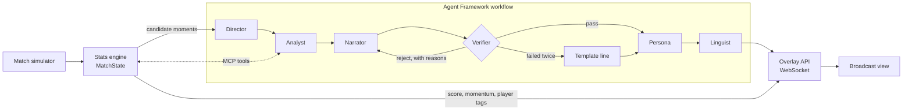

# Pitchside

**AI agents that explain the game, not just the score.**

Pitchside watches a synthetic football match event by event, works out which moments matter and why, checks every number before it goes on screen, and tells the story differently for each viewer: analyst or casual fan, your club, your player, in English, Hindi or Spanish.

Built for the Microsoft *Inside the Game* hackathon with Microsoft Foundry, Microsoft Agent Framework, MCP and Azure Container Apps.

- **Live app:** https://pitchside-web.mangostone-cc37c1d4.polandcentral.azurecontainerapps.io (pick a club and a player, choose 5x speed, kick off; the first load can take ~20 s while the container wakes up)
- **Demo video:** _link coming_


## Why I built this

> _Your sentence goes here, in your own words._

## What it does

One pipeline, five stages, as the challenge asks:

1. **Ingest.** A match simulator streams synthetic events (passes, carries, dribbles, shots, tackles, interceptions, pressure, fouls, cards, substitutions, sprints, possession changes) as they happen.
2. **Interpret.** A deterministic stats engine turns them into live numbers: possession, pass difficulty, xG, momentum, pressing intensity (PPDA), tempo and a control vs chaos index. It flags candidate moments with a significance score and the evidence behind each one.
3. **Explain.** Agents work out why a moment matters and back it up with numbers they fetch through MCP tools.
4. **Render.** Every insight becomes a timed overlay object ([schema](schemas/overlay.schema.json)) that a broadcast graphics system could draw over a live feed. The React app is one renderer.
5. **Personalize.** The same insight is rewritten for casual fans, analysts, a chosen club and a chosen player, then localized into Hindi and Spanish.

## How it works



**Numbers come from code, words come from agents.** The stats engine is the only source of numbers. Agents read it through an MCP server (`/mcp`), and the Verifier, which is plain code rather than another model call, checks every caption before it airs:

- every number must match a fact the stats engine produced, metric by metric for the Analyst's citations;
- a named player must be part of the moment;
- no end-of-match talk before the 80th minute, British plural verbs for clubs ("Kingsport press"), no chatbot phrases.

A rejected caption goes back to the Narrator with the reasons. If it fails twice, a template line built only from verified numbers airs instead, so the broadcast never waits.

| Agent | Job | Falls back to |
| --- | --- | --- |
| Director | Picks which moments air and when, keeps variety, never floods the screen | Rule: highest significance, varied type |
| Analyst | Explains why the moment matters, citing numbers fetched over MCP | The moment's own summary |
| Narrator | Writes a headline and a live line in commentator style | Template line |
| Verifier | Checks numbers, names, timing and style; sends drafts back | (plain code, cannot fail) |
| Persona | Rewrites for casual, analyst, club and player viewers | The verified base line |
| Linguist | Localizes into Hindi and Spanish, keeping numbers intact | English |

Shared state is one `MatchState` per match. Each live match gets its own key, and the Analyst's MCP client sends it as a header, so tools always answer for the right match. Live matches stream continuously while up to three moments are handled in parallel.

## Results

I ran the same five seeded matches (102 moments) through two setups with the same model (`gpt-4.1-mini`) and the same stats tools: one agent writing each caption directly, and the Pitchside agent team. [`evals/ab_test.py`](backend/evals/ab_test.py), raw output in `backend/evals/results.json`.

- **Wrong numbers:** neither setup stated a number the stats engine didn't have. Both were grounded on numbers, so I'm not claiming an accuracy gap there.
- **What the team adds:** the Verifier sent back 15 drafts across the five matches (wrong time references, a team's pressing credited to one player, singular club verbs); all were rewritten correctly, and 2 moments fell back to templates. The team also produces four viewer versions in three languages per moment, which a single caption can't.
- **Cost:** about 8.4 s per moment for the team vs 1.2 s for one agent. Live play absorbs this by running moments in parallel.
- **Foundry evaluations** (groundedness, relevance, coherence, fluency) on both sides: _results being added_.

## Brief coverage

| Brief item | Where |
| --- | --- |
| Ingest synthetic events as they happen | `backend/pitchside/sim`, `runner.py` |
| Interpret into stats, patterns, context | `backend/pitchside/stats` |
| Explain why moments matter (control vs chaos, pressure, rhythm) | stats engine moments + Analyst agent |
| Render on screen, timed and machine-readable | `overlays.py`, `schemas/overlay.schema.json`, `frontend/` |
| Personalize: modes, favourite club, favourite player | Persona agent, setup screen |
| Player identification with speed and distance triggers | `sprint` and `physical` events, player tags |
| Pass quality: distance, accuracy, difficulty | `stats/metrics.py` `pass_difficulty` |
| Ball speed and shot speed | simulator physics, `shot_speed_kmh`, `ball_speed_kmh` |
| Narratives, milestones, recaps | Narrator agent, milestone moments |
| Data innovation | the simulator, five sample matches in `data/samples`, `schemas/event.schema.json` |
| Multi-language storytelling | Linguist agent (Hindi, Spanish) |
| Auto-eventing from video | not built; see roadmap |

## The data

Everything is synthetic, with made-up clubs and players. The simulator is a possession-chain model: each action depends on where the ball is, who has it, how much pressure they're under, how tired they are and the score (a side that is behind after the hour presses higher and plays more directly). Calibrated over 20 seeds it averages about 2.9 goals, 80% pass completion, 22 shots and 20 fouls a match, and the hardest runner covers about 12 km. Any match replays exactly from its seed. Seed 16 with the `comeback` storyline is the demo match.

## Run it locally

```bash
cd backend
uv sync
uv run pytest                                   # 29 tests
PITCHSIDE_PROVIDER=templates uv run python -m pitchside.run   # whole match, no model needed
cp .env.example .env                            # add your Foundry endpoint, deployment and key
uv run uvicorn pitchside.api:app --port 8000

cd ../frontend && npm install && npm run dev    # http://localhost:5173
```

Generate a match: `uv run python -m pitchside.sim --seed 7 --out ../data/samples/seed7.jsonl`

Use the stats tools from any MCP client (for example GitHub Copilot in VS Code): point it at `http://localhost:8000/mcp/`.

## Deploy to Azure

`infra/main.bicep` provisions Log Analytics, Application Insights, a container registry, a Container Apps environment (Consumption profile) and the app, with the model key held as a Container Apps secret. `infra/deploy.sh` builds the image, pushes it and rolls it out. Agent traces are exported with OpenTelemetry to the Application Insights resource connected to the Foundry project, so every workflow run, agent call and tool call shows up in Foundry's tracing view.

Things I hit on an Azure for Students subscription: ACR Tasks are blocked (so the image is built locally), the default "express" Container Apps environment can't pull private images (so the Bicep asks for a Consumption workload profile), and Container Apps wanted OCI layer media types (`infra/oci_retag.py` rewrites the manifest).

## Limitations and next steps

- The event stream runs in-process; the next step is Azure Event Hubs between the simulator and the stats engine so several consumers can share one match.
- Spoken commentary uses the browser's speech engine; Azure AI Speech neural voices are the planned upgrade.
- Auto-eventing from video (running a pose and ball detection model over a feed) is out of scope for this build.
- The Verifier's style checks are rules; some wording slips through (for example a wrong time reference it doesn't have a rule for yet).

## Acknowledgements

Built with Microsoft Foundry, Microsoft Agent Framework, Azure Container Apps, Application Insights and the Model Context Protocol. I used Claude Code as a coding assistant during the build.

## License

MIT
